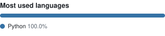
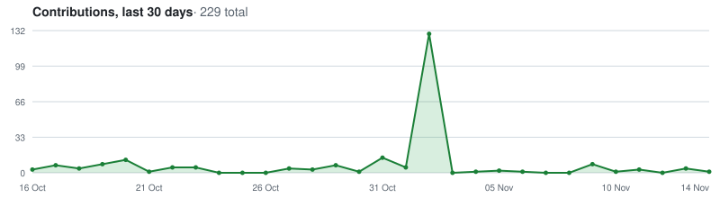

### Hi, I'm David 👋

**Projects**
- **[lucid-firewall-diagram-generator](https://github.com/davidquinney/lucid-firewall-diagram-generator):** generates Lucidchart network/firewall diagrams from rule data
- **[movedemosetup](https://github.com/davidquinney/movedemosetup):** quickly deploy or tear down a Nutanix Move demo environment, including security policies
- **[practice-ps-doc-automation](https://github.com/davidquinney/practice-ps-doc-automation):** professional-services documentation automation

<picture>
  <source media="(prefers-color-scheme: dark)" srcset="https://raw.githubusercontent.com/davidquinney/davidquinney/output/github-snake-dark.svg" />
  
</picture>

<picture>
  <source media="(prefers-color-scheme: dark)" srcset="https://raw.githubusercontent.com/davidquinney/davidquinney/output/top-langs-dark.svg" />
  
</picture>

<picture>
  <source media="(prefers-color-scheme: dark)" srcset="https://raw.githubusercontent.com/davidquinney/davidquinney/output/activity-graph-dark.svg" />
  
</picture>

**Recent activity**
<!--START_SECTION:activity-->
<!--END_SECTION:activity-->
